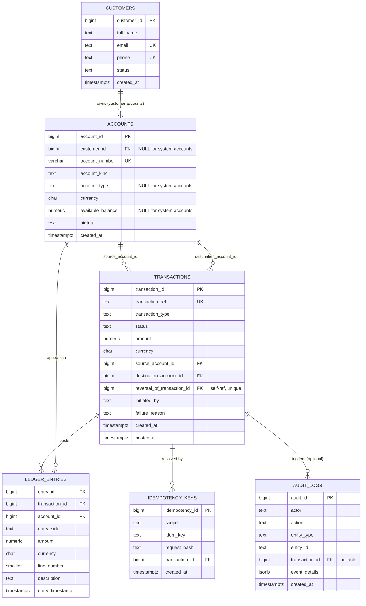

# Portfolio 1: Database Design and Modelling
## LedgerSpring Digital Bank (LSDB) — Relational Schema & Data Dictionary

**MIT 8103 Advanced Database Systems**  
**Primary database:** PostgreSQL 15+

---

## 1. Entity Summary and Relationships

> **Visual Diagram Export:** A high-resolution rendered diagram is available at [`../diagrams/Tijani_Mubarak_301915100_ERD_v2.png`](../diagrams/Tijani_Mubarak_301915100_ERD_v2.png) (editable draw.io model at [`../diagrams/Tijani_Mubarak_301915100_ERD_v2.drawio`](../diagrams/Tijani_Mubarak_301915100_ERD_v2.drawio)).

---

## 2. Table: `customers`

**Purpose:** Stores the identity and lifecycle status of every registered
LSDB customer. `customer_id` is the stable internal surrogate key used in all
FK references; it is never exposed as an account number or external identifier.

| Column | Type | Nullable | Default | Constraints | Description |
|---|---|:---:|---|---|---|
| `customer_id` | `BIGINT` | NO | IDENTITY | **PK** | Surrogate primary key. Auto-generated; never reused. |
| `full_name` | `TEXT` | NO | — | CHECK(len > 0) | Customer's full legal name. Must not be blank. |
| `email` | `TEXT` | YES | NULL | **UNIQUE** | Unique email address. NULL permitted when not provided. |
| `phone` | `TEXT` | YES | NULL | **UNIQUE** | Unique phone number. NULL permitted when not provided. |
| `status` | `TEXT` | NO | `'ACTIVE'` | CHECK IN ('ACTIVE', 'SUSPENDED', 'CLOSED') | Customer lifecycle state. Only ACTIVE customers may initiate money movement. |
| `created_at` | `TIMESTAMPTZ` | NO | `CURRENT_TIMESTAMP` | — | Registration timestamp in UTC. |

**Candidate keys:** `customer_id` (PK), `email` (where not null), `phone` (where not null).  
**Indexes:** partial unique indexes on `lower(email)` and `phone` for non-null values.

---

## 3. Table: `accounts`

**Purpose:** Stores both customer-owned accounts and internal system accounts
(settlement, suspense). The `account_kind` column distinguishes the two
populations, and a CHECK constraint enforces that customer accounts must have
an owner while system accounts must not.

| Column | Type | Nullable | Default | Constraints | Description |
|---|---|:---:|---|---|---|
| `account_id` | `BIGINT` | NO | IDENTITY | **PK** | Surrogate primary key. |
| `customer_id` | `BIGINT` | **YES** | NULL | **FK** → `customers` | Owner. NULL for SETTLEMENT/SUSPENSE system accounts. |
| `account_number` | `VARCHAR(20)` | NO | — | **UNIQUE** | Human-visible account identifier. Unique across all accounts. |
| `account_kind` | `TEXT` | NO | — | CHECK IN ('CUSTOMER', 'SETTLEMENT', 'SUSPENSE') | Distinguishes customer accounts from bank-controlled system accounts. |
| `account_type` | `TEXT` | YES | NULL | CHECK IN ('SAVINGS', 'CURRENT') | Applies only to CUSTOMER accounts. NULL for system accounts. |
| `currency` | `CHAR(3)` | NO | `'NGN'` | CHECK = 'NGN' | Currency code. NGN only in v1. |
| `available_balance` | `NUMERIC(19,2)` | YES | NULL | CHECK ≥ 0 | Cached balance for CUSTOMER accounts. NULL for system accounts. |
| `status` | `TEXT` | NO | `'ACTIVE'` | CHECK IN ('ACTIVE', 'SUSPENDED', 'CLOSED') | Account operational state. |
| `created_at` | `TIMESTAMPTZ` | NO | `CURRENT_TIMESTAMP` | — | Creation timestamp in UTC. |

**Cross-column CHECK constraint (`chk_account_kind_customer`):**
- If `account_kind = 'CUSTOMER'` then `customer_id IS NOT NULL`, `account_type IS NOT NULL`, and `available_balance IS NOT NULL`.
- If `account_kind IN ('SETTLEMENT', 'SUSPENSE')` then `customer_id IS NULL` and `account_type IS NULL`.

**Candidate keys:** `account_id` (PK), `account_number`.  
**Foreign keys:** `customer_id → customers(customer_id)` ON DELETE RESTRICT.

---

## 4. Table: `transactions`

**Purpose:** Durable record of every money-movement request and its final
outcome. Financial truth is stored in `ledger_entries`; the `transactions`
row is the request/status envelope.

| Column | Type | Nullable | Default | Constraints | Description |
|---|---|:---:|---|---|---|
| `transaction_id` | `BIGINT` | NO | IDENTITY | **PK** | Surrogate primary key. |
| `transaction_ref` | `TEXT` | NO | — | **UNIQUE** | Business-facing reference (e.g. `TXN-2026-TRF-001`). |
| `transaction_type` | `TEXT` | NO | — | CHECK IN ('DEPOSIT', 'WITHDRAWAL', 'TRANSFER', 'REVERSAL') | Nature of the money movement. |
| `status` | `TEXT` | NO | `'PENDING'` | CHECK IN ('PENDING', 'POSTED', 'FAILED') | Lifecycle state. POSTED means ledger entries exist and are balanced. |
| `amount` | `NUMERIC(19,2)` | NO | — | CHECK > 0 | Positive amount in NGN. |
| `currency` | `CHAR(3)` | NO | `'NGN'` | CHECK = 'NGN' | Currency. NGN only in v1. |
| `source_account_id` | `BIGINT` | YES | NULL | **FK** → `accounts` | Sending / debited account. NULL for incoming deposits if not tracked. |
| `destination_account_id` | `BIGINT` | YES | NULL | **FK** → `accounts` | Receiving / credited account. NULL for withdrawals if not tracked. |
| `reversal_of_transaction_id` | `BIGINT` | YES | NULL | **FK** → `transactions` (self), **UNIQUE** | References the original transaction being reversed. UNIQUE prevents double-reversal. |
| `initiated_by` | `TEXT` | NO | — | — | Actor identifier (customer_id, staff ID, or system label). |
| `failure_reason` | `TEXT` | YES | NULL | — | Populated on FAILED transactions. |
| `created_at` | `TIMESTAMPTZ` | NO | `CURRENT_TIMESTAMP` | — | Request creation timestamp. |
| `posted_at` | `TIMESTAMPTZ` | YES | NULL | — | Timestamp when the transaction reached POSTED status. |

**CHECK constraints:**
- `amount > 0` — no zero or negative transactions.
- Accounts differ — `source_account_id <> destination_account_id` when both are not null.
- Reversal type — `reversal_of_transaction_id IS NOT NULL` only when `transaction_type = 'REVERSAL'`.
- One reversal per original — `UNIQUE (reversal_of_transaction_id)` prevents two reversals of the same transaction.

---

## 5. Table: `ledger_entries`

**Purpose:** Double-entry accounting journal. Every POSTED transaction produces
at least two rows: one DEBIT and one CREDIT, whose amounts must be equal.
Rows are **immutable** once written; the application role is not granted
UPDATE or DELETE on this table.

| Column | Type | Nullable | Default | Constraints | Description |
|---|---|:---:|---|---|---|
| `entry_id` | `BIGINT` | NO | IDENTITY | **PK** | Surrogate primary key. |
| `transaction_id` | `BIGINT` | NO | — | **FK** → `transactions` | The posting transaction that generated this journal line. |
| `account_id` | `BIGINT` | NO | — | **FK** → `accounts` | The account affected by this journal line. |
| `entry_side` | `TEXT` | NO | — | CHECK IN ('DEBIT', 'CREDIT') | Debit reduces the account balance; credit increases it. |
| `amount` | `NUMERIC(19,2)` | NO | — | CHECK > 0 | Positive amount. Debit/credit direction is encoded in `entry_side`. |
| `currency` | `CHAR(3)` | NO | `'NGN'` | CHECK = 'NGN' | Currency. |
| `line_number` | `SMALLINT` | NO | 1 | CHECK > 0 | Sequential order within the transaction journal. |
| `description` | `TEXT` | YES | NULL | — | Human-readable explanation of the posting line. |
| `entry_timestamp` | `TIMESTAMPTZ` | NO | `CURRENT_TIMESTAMP` | — | Posting timestamp in UTC. |

**Balance invariant (enforced by posting procedure, tested by reconciliation query):**  
For every POSTED `transaction_id`:  
`SUM(amount WHERE entry_side = 'DEBIT') = SUM(amount WHERE entry_side = 'CREDIT')`

---

## 6. Table: `idempotency_keys`

**Purpose:** Prevents duplicate financial effects caused by retried requests.
A retry with the same `(scope, idem_key)` finds the existing record and
returns the already-posted transaction, rather than creating a new one.

| Column | Type | Nullable | Default | Constraints | Description |
|---|---|:---:|---|---|---|
| `idempotency_id` | `BIGINT` | NO | IDENTITY | **PK** | Surrogate primary key. |
| `scope` | `TEXT` | NO | — | UNIQUE (scope, idem_key) | Namespace for the key; typically the initiating `customer_id` or service ID. |
| `idem_key` | `TEXT` | NO | — | UNIQUE (scope, idem_key) | Client-supplied idempotency key. |
| `request_hash` | `TEXT` | NO | — | — | SHA-256 of the canonical request payload. A different hash with the same scope/key is a conflict. |
| `transaction_id` | `BIGINT` | YES | NULL | **FK** → `transactions` | Resolves to the transaction created or found by the original request. |
| `created_at` | `TIMESTAMPTZ` | NO | `CURRENT_TIMESTAMP` | — | First-seen timestamp. |

**Candidate keys:** `idempotency_id` (PK), `(scope, idem_key)`.

---

## 7. Table: `audit_logs`

**Purpose:** Append-only record of significant actions performed by customers,
staff, and the platform service. Used for security review, operations
investigation, and compliance. Must not be used to derive financial balances.
The application role is granted INSERT only.

| Column | Type | Nullable | Default | Constraints | Description |
|---|---|:---:|---|---|---|
| `audit_id` | `BIGINT` | NO | IDENTITY | **PK** | Surrogate primary key. |
| `actor` | `TEXT` | NO | — | NOT NULL | Identifier of the person or service that performed the action. |
| `action` | `TEXT` | NO | — | NOT NULL | Action label (e.g. `TRANSACTION_POSTED`, `ACCOUNT_SUSPENDED`). |
| `entity_type` | `TEXT` | NO | — | NOT NULL | Type of the affected entity (e.g. `TRANSACTION`, `ACCOUNT`, `CUSTOMER`). |
| `entity_id` | `TEXT` | YES | NULL | — | Identifier of the specific affected entity. |
| `transaction_id` | `BIGINT` | YES | NULL | **FK** → `transactions` | Optional FK to the triggering transaction. |
| `event_details` | `JSONB` | YES | NULL | — | Structured metadata. Must not contain passwords, BVN, full card numbers, or raw credentials. |
| `created_at` | `TIMESTAMPTZ` | NO | `CURRENT_TIMESTAMP` | — | Event timestamp in UTC. |

---

## 8. Foreign Key Map

| FK Column (child table) | References | On Delete |
|---|---|---|
| `accounts.customer_id` | `customers(customer_id)` | RESTRICT |
| `transactions.source_account_id` | `accounts(account_id)` | (default: NO ACTION) |
| `transactions.destination_account_id` | `accounts(account_id)` | (default: NO ACTION) |
| `transactions.reversal_of_transaction_id` | `transactions(transaction_id)` (self) | (default: NO ACTION) |
| `ledger_entries.transaction_id` | `transactions(transaction_id)` | (default: NO ACTION) |
| `ledger_entries.account_id` | `accounts(account_id)` | (default: NO ACTION) |
| `idempotency_keys.transaction_id` | `transactions(transaction_id)` | (default: NO ACTION) |
| `audit_logs.transaction_id` | `transactions(transaction_id)` | (default: NO ACTION) |

---

## 9. Index Inventory

| Index name | Table | Columns | Type | Justification |
|---|---|---|---|---|
| `idx_customers_email` | `customers` | `lower(email)` WHERE email IS NOT NULL | B-tree (partial) | Case-insensitive email lookup during login and de-duplication. |
| `idx_customers_phone` | `customers` | `phone` WHERE phone IS NOT NULL | B-tree (partial) | Phone lookup during login. |
| `idx_accounts_account_number` | `accounts` | `account_number` | B-tree | Primary customer-facing account lookup. |
| `idx_accounts_customer_id` | `accounts` | `customer_id` WHERE customer_id IS NOT NULL | B-tree (partial) | List all accounts for a customer. |
| `idx_transactions_ref` | `transactions` | `transaction_ref` | B-tree | Transaction detail lookup by reference — the primary operational query. |
| `idx_transactions_source` | `transactions` | `(source_account_id, created_at DESC)` WHERE source_account_id IS NOT NULL | B-tree (partial) | Sender transaction history, paginated newest-first. |
| `idx_transactions_destination` | `transactions` | `(destination_account_id, created_at DESC)` WHERE destination_account_id IS NOT NULL | B-tree (partial) | Recipient transaction history, paginated newest-first. |
| `idx_transactions_status_time` | `transactions` | `(status, created_at DESC)` WHERE status IN ('PENDING', 'FAILED') | B-tree (partial) | Operations team query: find unresolved transactions in a time window. |
| `idx_ledger_entries_transaction_id` | `ledger_entries` | `transaction_id` | B-tree | Efficient join from `transactions` to its journal lines. |
| `idx_ledger_entries_account_id` | `ledger_entries` | `(account_id, entry_timestamp DESC)` | B-tree | Account-level ledger queries and balance reconciliation. |
| `uq_idempotency_scope_key` | `idempotency_keys` | `(scope, idem_key)` | B-tree (unique) | Idempotency guard; also covers fast key lookup. No separate index needed. |

**Trade-off note:** Each index consumes storage and adds overhead to INSERT and
UPDATE operations. Partial indexes on nullable or filtered columns minimise
the size and maintenance cost while keeping the index selective for its target
query. Sequential scans remain appropriate for small tables or queries that
return most rows.
